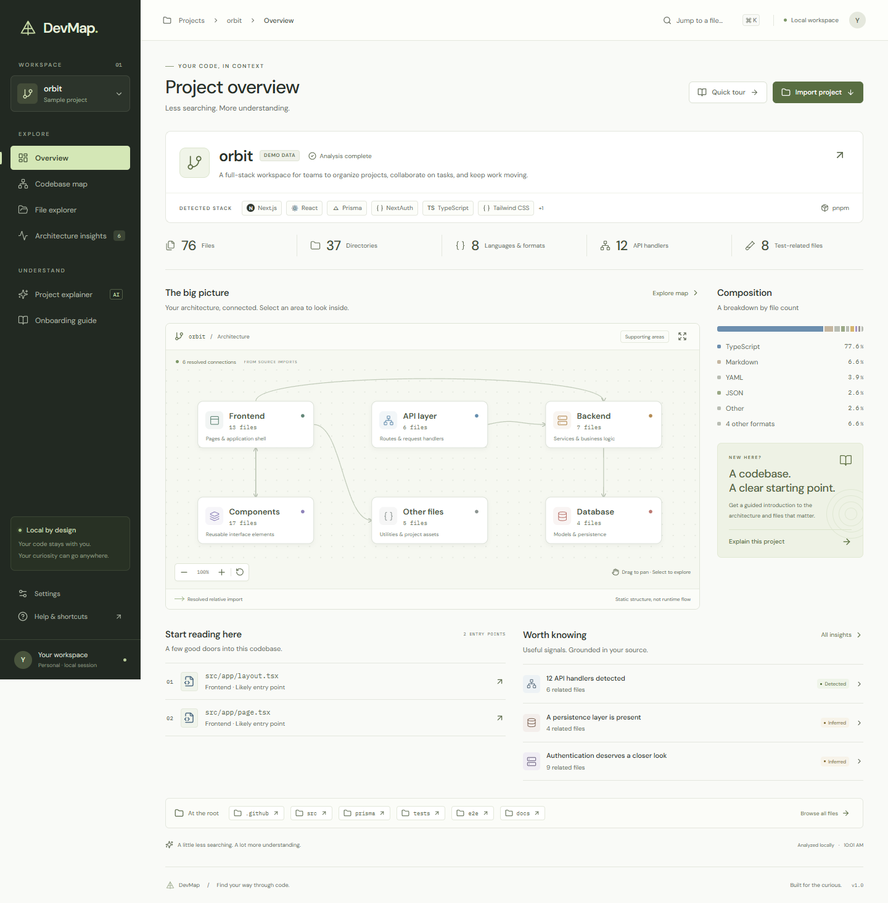

# DevMap

**Find your way through code.** A local-first project intelligence workspace that turns an unfamiliar repository into an explorable map, source inventory, and practical onboarding guide.

Built with React, TypeScript, and Vite. No backend, account, external API key, or language model is required for the core application.



## Run locally

Requires Node.js **22.12+** (or 20.19+) and npm.

```sh
npm install
npm run dev
```

Open the local URL printed by Vite, normally **http://127.0.0.1:5173**. The application opens with **Orbit**, a clearly labeled, 76-file full-stack sample repository. Demo files are analyzed by exactly the same pipeline as imported files. Orbit is an illustrative source fixture, not a runnable or security-reviewed application.

To inspect your own code, choose **Import project → Browse folders**, then select the repository root. Modern Chrome, Edge, Firefox, and Safari versions supporting directory file inputs can import folders. Folder selection is read-only: DevMap never modifies or executes imported code.

## What you can do

- **Overview:** inspect the detected stack, package manager, file and directory counts, language/format distribution, entry points, HTTP handlers, and architectural areas.
- **Codebase map:** pan, zoom, select or focus areas, inspect associated files, and view the source evidence behind cross-area import relationships. Mobile uses an area list instead of a shrunken canvas.
- **File explorer:** expand folders, search paths, filter extensions, highlight important files, and inspect source previews, size, line count, imports, and HTTP declarations.
- **Architecture insights:** distinguish **detected** source patterns, **inferred** interpretations, and **unknown** behavior. Inspect authentication candidates, database files, tests, config, large files, and deep nesting.
- **Project explainer:** ask supported structural questions with the built-in local analysis provider, or connect a local Ollama model for open-ended AI explanations. Answers link to relevant source files. Provider failure falls back to local analysis.
- **Onboarding guide:** explore eight sections covering purpose, architecture, directories, important files, data flow, authentication, reading order, and setup. Export the guide as Markdown.

The local explainer is deterministic, evidence-based analysis, **not a language model**. Unknown questions are labeled honestly. A filename-based insight is not a runtime, security, or test-coverage guarantee.

## Optional Ollama integration

Install and start [Ollama](https://docs.ollama.com/), then install a model:

```sh
ollama pull qwen2.5-coder:7b
```

In **Settings**, select **Ollama**, enter `http://localhost:11434`, select an installed model, and use **Test connection**. Save the provider, then ask a question in Project explainer.

The browser calls Ollama's [`/api/tags` and `/api/chat` endpoints](https://docs.ollama.com/api/chat) directly. If the browser reports a cross-origin error, configure the Ollama process to allow the exact DevMap origin, for example:

```powershell
# Close an already-running Ollama instance before starting this one.
$env:OLLAMA_ORIGINS="http://127.0.0.1:5173,http://localhost:5173"
ollama serve
```

Only loopback HTTP(S) endpoints are accepted. No external provider is enabled by default. The `AIProvider` interface in `src/lib/ai.ts` keeps provider implementation separate from the UI; add another implementation to support another service.

On submission, Ollama receives bounded project metadata, the latest conversation turns, and selected source excerpts. Known secret-file contents are excluded; arbitrary source files can still contain hardcoded secrets. Read the provider notice before enabling it. A language model's answers are labeled inferred and need source verification. Connection checks time out after five seconds; generation after 90 seconds. Generation can be canceled.

## Privacy, scope, and honest limits

For an optional end-to-end check against a running local model, start DevMap with `npm run dev`, then run `npm run test:ollama`. This sends only the built-in demo context to the local model and verifies a real browser response. It is separate from the deterministic test suite.

- Imported file contents and conversations live in browser memory. Refreshing returns to the demo. Only provider preferences are stored in local storage.
- No analytics, remote font requests, background uploads, repository execution, or credential storage. Fonts are bundled locally. The development server binds to loopback by default.
- Known secret files (`.env`, private keys, credentials/secrets filenames) are inventoried without reading their contents. `.env.example`, `.sample`, and `.template` files can be read. This is a filename safeguard, not a comprehensive secret scanner.
- `node_modules`, `.git`, build outputs, caches, virtual environments, and similar generated directories are excluded. Custom `.gitignore` rules are not interpreted.
- Import is capped at **8,000 eligible files**, **256 KB per text file**, and **24 MB total text**. Larger/unreadable/unsupported content keeps metadata where possible, with explicit analysis notes. Previews show at most 600 lines; the tree renders up to 500 visible entries at a time. Search narrows the full inventory.
- Browser directory inputs expose files, not empty directories. Counts cover included files and their nonempty parent directories.
- Language distribution is **by file count**, including configuration and documentation formats; it is not a line- or byte-weighted language metric.
- Frameworks are identified from supported dependency declarations and configuration signatures. Root package scripts are shown verbatim and never executed. A manifest declaration does not prove a dependency is installed or used.
- The map resolves **relative JavaScript/TypeScript imports**. Package imports, aliases, dynamic expressions, and other language module systems are not resolved. Area labels use directory conventions. Connections are static dependencies, not measured request flow. Missing edges do not establish that a file is isolated.
- HTTP handler detection covers conventional Next.js App Router exports, literal Express-style `app/router/server.method` calls, and Python `@app/@router` method decorators. This is pattern matching, not a complete parser: dynamic routing, prefixes, wrappers, comments/strings, and other frameworks can require manual inspection. Counts are handler declarations, not guaranteed unique deployed endpoints.
- Authentication and database findings are candidate files/configuration, not security or connectivity validation. DevMap does not infer passing tests or coverage from test filenames.

## Keyboard and accessibility

| Action                              | Shortcut                |
| ----------------------------------- | ----------------------- |
| Jump to a file                      | Ctrl / ⌘ K              |
| Close a dialog or mobile navigation | Escape                  |
| Navigate visible file tree items    | Up / Down, Home / End   |
| Expand / collapse a directory       | Right / Left            |
| Select a map node                   | Tab, then Enter / Space |
| Pan a focused map canvas            | Arrow keys              |
| Zoom a focused map canvas           | + / −                   |
| Reset a focused map canvas          | 0                       |

Semantic navigation, visible focus, native modal focus trapping/restoration, inert closed mobile navigation, reduced-motion support, and high-contrast text are included. Source previews are keyboard-scrollable. Automated accessibility testing is useful coverage, not a substitute for a complete assistive-technology audit.

## Development and checks

```sh
npm run typecheck
npm run lint
npm test
npm run test:e2e
npm run build
npm run preview
```

Browser tests use an installed Google Chrome through Playwright's `chrome` channel. Alternatively install Playwright Chromium and adjust the channel in `playwright.config.ts`. The tests start a local Vite server automatically if one is not running.

Unit tests cover analysis evidence, ignored/unsafe paths, secrets, malformed manifests, empty and large projects, imports, route declarations, guide exports, local explanations, and provider validation. Browser tests cover real folder selection, map interaction, filters, source navigation, dialog focus, Markdown download, provider fallback, mobile behavior, and axe WCAG A/AA checks. Test screenshots and accessibility reports are written to `test-results/` (gitignored).

## Structure

```text
src/
  types.ts                     Shared project and provider contracts
  lib/
    analyzer.ts                Import limits, inventory, detection, import graph
    demo.ts                    Realistic bundled sample source files
    ai.ts                      AIProvider, local analysis, Ollama adapter
    guide.ts                   Evidence-based onboarding and Markdown export
  components/
    Overview.tsx               Overview, stack, metrics, reading suggestions
    ArchitectureMap.tsx        Interactive SVG graph and mobile area list
    FileExplorer.tsx           Searchable tree and source/metadata panel
    Explainer.tsx              Lazy-loaded conversation view
    ProviderSettings.tsx       Local provider configuration
    shared.tsx                 Accessible dialogs and shared UI
  App.tsx                      Navigation and workspace orchestration
  styles.css                   Responsive visual system
tests/
  analyzer.test.ts             Unit tests
  e2e/app.spec.ts              Browser and accessibility checks
```

For production, serve `dist/` using any static web host after `npm run build`. [Vite's deployment guide](https://vite.dev/guide/static-deploy.html) covers common options. Hash-based navigation works without server route rewrites. A secure context (`localhost` or HTTPS) is recommended for clipboard and browser APIs.
